<p align="center">
  
</p>

<p align="center">
  <a href="https://www.linkedin.com/in/jeymi-torres-bb08222a4/"></a>
  <!-- Opcional: descomenta y pon tu correo si quieres mostrarlo
  <a href="mailto:TU_CORREO@ejemplo.com"></a>
  -->
  
</p>

---

## 👩‍💻 Sobre mí

Me dedico a **automatizar procesos con inteligencia artificial**. Combino plataformas de automatización como **n8n, Power Automate y Power Apps** con modelos de IA como **Claude, Copilot y ChatGPT** para crear flujos que clasifican, validan y procesan información sin trabajo manual.

Vengo de **más de 5 años en el sector financiero**, donde aprendí a detectar tareas repetitivas, medir su costo y convertirlas en procesos automáticos, confiables y fáciles de auditar.

- 🤖 Actualmente: construyendo agentes y flujos con IA para procesos operativos.
- 🛠️ Desarrollo con: **Claude Code** y **GitHub Copilot** como asistentes de programación en Python.
- 🌱 Aprendiendo: **Make** y **Zapier**, agentes de IA, integración de APIs y Python para automatización.
- 💬 Pregúntame sobre: automatización de procesos, Power Platform y cómo aplicar IA en tareas del día a día.

---

## 🧭 Lo que hago

<table>
  <tr>
    <td width="33%" valign="top">
      <h3>⚙️ Flujos de automatización</h3>
      Integro apps y datos con n8n, Power Automate y Power Apps: formularios, correos, hojas de cálculo, CRMs y SharePoint conectados sin intervención manual.
    </td>
    <td width="33%" valign="top">
      <h3>🤖 Agentes y asistentes con IA</h3>
      Agrego IA a los procesos para clasificar solicitudes, extraer datos de documentos, resumir información y apoyar decisiones con Claude, Copilot y ChatGPT.
    </td>
    <td width="33%" valign="top">
      <h3>📊 Datos para medir el impacto</h3>
      Dashboards en Power BI y consultas SQL para medir tiempos, errores y ahorro, y demostrar el valor de cada automatización.
    </td>
  </tr>
</table>

---

## 📊 Impacto en números

<div align="center">

| ⏱️ Ahorro identificado | 🗂️ Expedientes validados | 🎯 Precisión | 📅 Experiencia |
|:---:|:---:|:---:|:---:|
| **hasta 6 h/semana** | **3,265** | **> 99.9 %** | **5+ años** en finanzas |

</div>

---

## 🔄 Cómo trabajo

```text
1. Detectar     →  ¿Qué tarea repetitiva consume más tiempo o genera más errores?
2. Diseñar      →  Mapear el flujo: disparador, datos, reglas y dónde aporta la IA.
3. Automatizar  →  Construir con n8n o Power Automate + un modelo de IA.
4. Medir        →  Comparar tiempo y errores antes y después con un dashboard.
```

---

## 🛠️ Tecnologías y herramientas

**Automatización**

<table>
  <tr>
    <td align="center" width="96">
      <br>
      <sub><b>n8n</b></sub>
    </td>
    <td align="center" width="96">
      <br>
      <sub><b>Power Automate</b></sub>
    </td>
    <td align="center" width="96">
      <br>
      <sub><b>Power Apps</b></sub>
    </td>
  </tr>
</table>

**Inteligencia artificial**

<table>
  <tr>
    <td align="center" width="96">
      <br>
      <sub><b>Claude Code</b></sub>
    </td>
    <td align="center" width="96">
      <br>
      <sub><b>Claude</b></sub>
    </td>
    <td align="center" width="96">
      <br>
      <sub><b>GitHub Copilot</b></sub>
    </td>
    <td align="center" width="96">
      <br>
      <sub><b>Microsoft Copilot</b></sub>
    </td>
    <td align="center" width="96">
      <br>
      <sub><b>ChatGPT</b></sub>
    </td>
  </tr>
</table>

**Datos**

<table>
  <tr>
    <td align="center" width="96">
      <br>
      <sub><b>Power BI</b></sub>
    </td>
    <td align="center" width="96">
      <br>
      <sub><b>SQL</b></sub>
    </td>
    <td align="center" width="96">
      <br>
      <sub><b>Excel</b></sub>
    </td>
    <td align="center" width="96">
      <br>
      <sub><b>SharePoint</b></sub>
    </td>
    <td align="center" width="96">
      <br>
      <sub><b>Dataverse</b></sub>
    </td>
  </tr>
</table>

**Desarrollo**

<table>
  <tr>
    <td align="center" width="96">
      <br>
      <sub><b>Python</b></sub>
    </td>
    <td align="center" width="96">
      <br>
      <sub><b>JavaScript</b></sub>
    </td>
    <td align="center" width="96">
      <br>
      <sub><b>HTML5</b></sub>
    </td>
    <td align="center" width="96">
      <br>
      <sub><b>CSS3</b></sub>
    </td>
    <td align="center" width="96">
      <br>
      <sub><b>Git</b></sub>
    </td>
    <td align="center" width="96">
      <br>
      <sub><b>GitHub</b></sub>
    </td>
    <td align="center" width="96">
      <br>
      <sub><b>VS Code</b></sub>
    </td>
  </tr>
</table>

**🌱 Aprendiendo**

<table>
  <tr>
    <td align="center" width="96">
      <br>
      <sub><b>Make</b></sub>
    </td>
    <td align="center" width="96">
      <br>
      <sub><b>Zapier</b></sub>
    </td>
  </tr>
</table>

---

## 📂 Proyectos

| Proyecto | Descripción | Tecnologías | Estado |
|---|---|---|---|
| **Clasificador de solicitudes con IA** | Flujo que recibe solicitudes por correo o formulario, las clasifica con IA, extrae los datos clave y las registra en una hoja de cálculo. | n8n · Claude / ChatGPT · Google Sheets | 🚧 En construcción |
| **Validación de documentos con IA** | Revisa expedientes, detecta datos faltantes o inconsistentes y avisa al responsable. | Power Automate · Power Apps · IA · SharePoint | 🚧 En construcción |
| **Reporte semanal automático** | Junta datos de varias fuentes, genera un resumen con IA y lo envía cada semana. | n8n · Python · Power BI | 🚧 En construcción |
| **Scripts de automatización con Claude Code** | Herramientas en Python creadas con asistencia de IA para limpiar y transformar archivos de Excel. | Python · Claude Code · Copilot | 🚧 En construcción |
| [**Portafolio web**](https://github.com/JeymiTorres/PORTAFOLIOJEY) | Mi portafolio personal en desarrollo. | HTML · CSS · JavaScript | ✅ Disponible |

> Voy actualizando esta sección conforme publico y documento cada proyecto.

---

## 🎯 Mi objetivo

Ayudar a equipos y empresas a **dejar de hacer a mano lo que una automatización con IA puede hacer mejor**, con soluciones **medibles, confiables y fáciles de mantener**.

---

<p align="center">
  <b>Automatizo procesos con IA para que las personas se enfoquen en lo importante ✨</b><br>
  <a href="https://www.linkedin.com/in/jeymi-torres-bb08222a4/">¡Conectemos en LinkedIn!</a>
</p>
